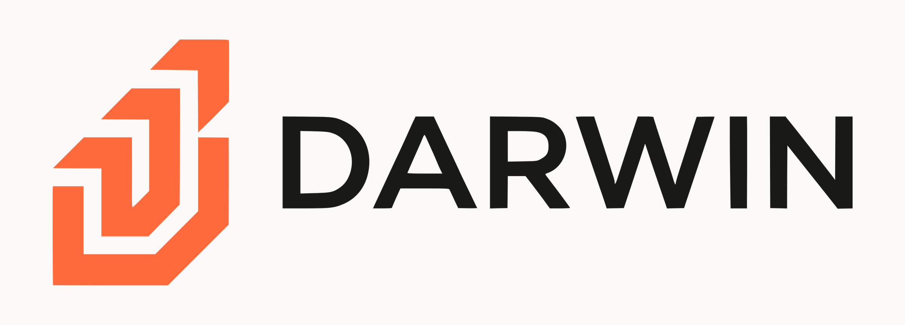

[message=%40darwin_market(https://img.shields.io/badge/X-@darwin__market-ff6a3d?style=flat&logo=x&logoColor=white)color=ff6a3d(https://img.shields.io/badge/X-@darwin__market-ff6a3d?style=flat&logo=x&logoColor=white)style=flat(https://img.shields.io/badge/X-@darwin__market-ff6a3d?style=flat&logo=x&logoColor=white)logo=x(https://img.shields.io/badge/X-@darwin__market-ff6a3d?style=flat&logo=x&logoColor=white)logoColor=white)](https://x.com/darwin_market)

### One token, a whole strategy.
